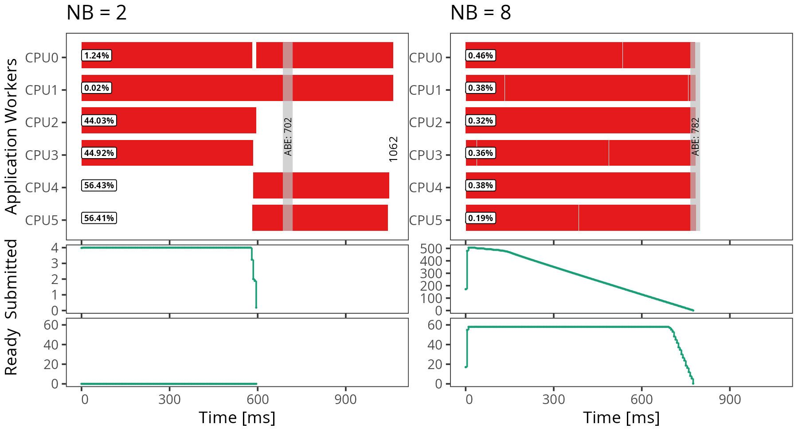
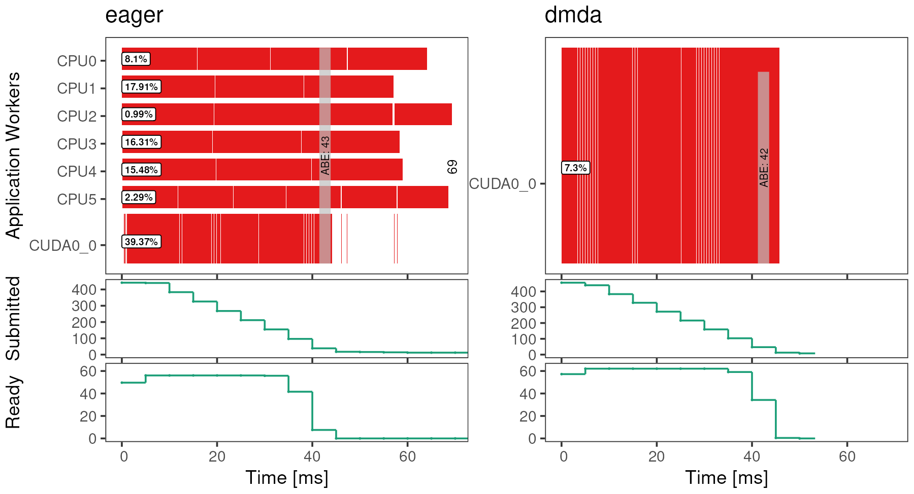

# -*- coding: utf-8 -*-
# -*- mode: org -*-
#+startup: beamer overview indent

#+TITLE: Development of Parallel Applications with the Task-Based Paradigm and the StarPU Runtime
#+AUTHOR: Lucas Mello Schnorr, Vinícius Garcia Pinto, Raymond Namyst, Samuel Thibault
#+DATE: SSCAD 2026 --- Minicurso 3 --- \url{https://github.com/schnorr/starpu-tutorial}
#+OPTIONS: H:2 num:t toc:nil \n:nil @:t ::t |:t ^:t -:t f:t *:t <:t title:nil
#+LANGUAGE: en
#+TAGS: noexport(n) ignore(i)
#+EXPORT_EXCLUDE_TAGS: noexport
#+EXPORT_SELECT_TAGS: export

#+LaTeX_CLASS: beamer
#+LaTeX_CLASS_OPTIONS: [presentation, aspectratio=169]
#+BEAMER_THEME: metropolis [numbering=fraction, progressbar=frametitle]
#+LATEX_HEADER: \usepackage{palatino}
#+LATEX_HEADER: \usepackage{booktabs}
#+LATEX_HEADER: \setbeamerfont{title}{size=\large}
#+LATEX_HEADER: \setbeamerfont{author}{size=\small}

#+LaTeX: \setbeamertemplate{navigation symbols}{}
#+LaTeX: \maketitle

* About this deck                                                  :noexport:

Slides of the three exposition blocks of the minicurso (Tuesday,
2026-11-03, 14:00-16:10, 130 min without break). The hands-on parts in
between are in =../handout.org=; the frames titled "Hands-on" mark the
moments to switch to it. Each block follows a section of the book
chapter, whose figures and listings are reused here.

| Block     | Time  | Min | Chapter |
|-----------+-------+-----+---------|
| Opening   | 14:00 |  10 | ---      |
| Concepts  | 14:10 |  15 | 3.1--3.2 |
| StarPU    | 14:40 |  15 | 3.3      |
| Traces    | 15:25 |  10 | 3.5      |
| Closing   | 16:00 |  10 | 3.6      |

* Opening

** Today, 14:00--16:10, no break

#+ATTR_LATEX: :align llll
| 14:00 | 10 min | Opening, start the containers   |                    |
| 14:10 | 15 min | Concepts: tasks, DAG, STF       | exposition         |
| 14:25 | 15 min | *Hands-on 1*: first programs    | =hello_world=, =vector_scal= |
| 14:40 | 15 min | The StarPU runtime              | exposition         |
| 14:55 | 30 min | *Hands-on 2*: tiled GEMM        | =gemm_starpu=, GPU demo |
| 15:25 | 10 min | Observing executions            | exposition         |
| 15:35 | 25 min | *Hands-on 3*: traces and StarVZ | =starvz=           |
| 16:00 | 10 min | Closing, questions              |                    |

Everything is in the companion repository and in the book chapter.

** Start the StarPU container now

First load the two images (handout, "Opening": from the archives
distributed in the room, or with =podman pull=). Then:

#+LaTeX: \footnotesize
#+begin_src bash
git clone https://github.com/schnorr/starpu-tutorial.git
cd starpu-tutorial
podman run -it --userns=keep-id \
    --mount type=bind,src="$(pwd)",target=/home/starpu/mount \
    registry.gitlab.inria.fr/starpu/starpu-docker/starpu:latest
# inside the container
starpu_machine_display -notopology
#+end_src
#+LaTeX: \normalsize

You should see one CPU worker per core. Keep this shell open.

* Concepts: tasks, DAG, STF

** A typical HPC node

- One or more multicore processors, one or more GPUs.
- Each GPU has its own *device memory*, linked to the *host memory*
  by PCIe: 16 GB/s (PCIe 3.0 x16) to 63 GB/s (PCIe 5.0 x16).
- The bus is much slower than either memory.

Goal: compute $C \leftarrow C + A B$ using *every* core and the GPU.

** Programming it by hand

#+LaTeX: \scriptsize
#+begin_src c
unsigned jgpu = NB * 0.8;  /* GPU share: tuned by hand for this node */
cudaMemcpy(dA, A, ...); cudaMemcpy(dB, B, ...); cudaMemcpy(dC, C, ...);
cublasSgemm(handle, ..., gpu_cols, ...);              /* asynchronous */
omp_set_num_threads(ncores - 1);    /* one core drives the GPU */
#pragma omp parallel for collapse(2) proc_bind(close)
for (unsigned j = jgpu; j < NB; j++)
    for (unsigned i = 0; i < NB; i++)
        for (unsigned k = 0; k < NB; k++)
            gemm_block(BS, N, BLK(A, i, k), BLK(B, k, j), BLK(C, i, j));
cudaMemcpy(C, dC, ...);
#+end_src
#+LaTeX: \normalsize

Every line hides a decision valid for one machine only:
1. *balancing* the work, 2. *managing* memory transfers,
3. *pinning* threads, 4. *porting* to another node.

** The task-based paradigm

- The programmer describes *what*: tasks, the data they access, and
  how they access it.
- A *runtime system* decides *where* and *when* each task runs, and
  moves the data accordingly.
- Implemented by PaRSEC, OmpSs, XKaapi, OpenMP (tasks with
  dependencies, 4.0), and *StarPU*.

** Tasks, data, access modes

- *Task*: a sequential function applied to *data blocks*.
- Tiled GEMM: one task per $(i, j, k)$ computes
  $C_{ij} \leftarrow C_{ij} + A_{ik} B_{kj}$.
- Each task declares an *access mode* per block:
  R for $A_{ik}$ and $B_{kj}$, *RW* for $C_{ij}$ (W only would be a bug).

Dependencies follow from the modes, in submission order:

| RAW | $T_1$ writes, $T_2$ reads      | true dependency      |
| WAR | $T_1$ reads, $T_2$ overwrites  | keep the old value   |
| WAW | both write                     | keep the order       |

The programmer never writes them: they are *implicit*.

** The DAG of the tiled product, $NB = 2$

#+ATTR_LATEX: :width 0.95\linewidth
[[./img/dag_gemm_2x2.pdf]]

Four independent chains of two tasks: each $C_{ij}$ is updated twice
(RAW), $A$ and $B$ are only read.

** Work, critical path, granularity

- *Work* $T_1$: $NB^3$ block products.
- *Critical path* $T_\infty$: $NB$ block products (one per $k$).
- $T_1 / T_\infty = NB^2$ bounds the number of busy processors:
  with $NB = 2$, at most *4* tasks at a time.

Granularity is a trade-off:
- larger $NB$ $\Rightarrow$ more parallelism, smaller tasks
  ($2\,BS^3$ flops each);
- the cost per task is roughly constant, and GPUs need large blocks.

One of the few performance decisions left to the programmer.

** Sequential Task Flow (STF)

#+LaTeX: \scriptsize
#+begin_src c
for (unsigned i = 0; i < NB; i++)            /* the loops do not change */
    for (unsigned j = 0; j < NB; j++)
        for (unsigned k = 0; k < NB; k++)
            starpu_task_insert(&gemm_cl,     /* was: gemm_block(...) */
                STARPU_R,  starpu_data_get_sub_data(A_h, 2, i, k),
                STARPU_R,  starpu_data_get_sub_data(B_h, 2, k, j),
                STARPU_RW, starpu_data_get_sub_data(C_h, 2, i, j), 0);
starpu_task_wait_for_all();
#+end_src
#+LaTeX: \normalsize

- Submission is *asynchronous*; the runtime builds the DAG on the fly.
- Ready tasks run on any free unit while the main thread submits.
- Sequential semantics, parallel execution.

** Hands-on 1 (15 min) --- first programs

Handout, section "Hands-on 1":
1. Build the examples with =make=.
2. Run =hello_world= with 1, 2 and 4 workers.
3. Run =vector_scal=: two tasks, one RW dependency.

* The StarPU runtime

** StarPU in the software stack

#+ATTR_LATEX: :height 0.6\textheight
[[./img/stack-full.pdf]]

C interface implementing STF; CPUs, CUDA, HIP, OpenCL, clusters with
StarPU-MPI. Developed at Inria Bordeaux (STORM team).

** Three components, three problems solved

- *Scheduler* (balancing): each ready task goes to a worker, chosen by
  a scheduling policy --- from greedy to model-based.
- *Memory nodes* (transfers): main memory and each GPU memory; StarPU
  tracks valid copies and moves blocks before a task needs them.
- *Workers* (pinning): one thread per CPU core, one per GPU (on a
  dedicated core); one task at a time, no preemption.

Programmer-side abstractions: *codelet* (a kind of task), *data handle*
(a registered block), *task* (a codelet applied to handles).

** Codelets and tasks

#+LaTeX: \scriptsize
#+begin_src c
void hello_cpu(void *buffers[], void *cl_arg)
{
    printf("Hello world from worker %d\n", starpu_worker_get_id());
    sleep(1);
}
struct starpu_codelet hello_cl = {
    .cpu_funcs = { hello_cpu }, .nbuffers = 0, .name = "hello",
};
int main(void)
{
    starpu_init(NULL);
    for (int i = 0; i < 4; i++)
        starpu_task_insert(&hello_cl, 0);
    starpu_task_wait_for_all();
    starpu_shutdown();
}
#+end_src

** Data handles and access modes

#+LaTeX: \scriptsize
#+begin_src c
struct starpu_codelet scal_cl = {
    .cpu_funcs = { scal_cpu }, .nbuffers = 1, .modes = { STARPU_RW },
};
starpu_data_handle_t vector_h;
starpu_vector_data_register(&vector_h, STARPU_MAIN_RAM,
                            (uintptr_t)vector, NX, sizeof(vector[0]));
starpu_task_insert(&scal_cl, STARPU_RW, vector_h,
                   STARPU_VALUE, &two, sizeof(two), 0);
starpu_task_insert(&scal_cl, STARPU_RW, vector_h,
                   STARPU_VALUE, &three, sizeof(three), 0);
starpu_data_unregister(vector_h);   /* data back in main memory */
#+end_src
#+LaTeX: \normalsize

- StarPU infers RAW: the second task waits for the first.
- Inside a task, =STARPU_VECTOR_GET_PTR= gives the address *in the
  memory node where the task runs*.

** Partitioning and coherence

- *Filters* split a registered matrix into a grid of sub-handles:
  =starpu_matrix_filter_block= and =..._vertical_block=, applied with
  =starpu_data_map_filters()=.
- Dependencies are computed *per block*.
- Coherence protocol, as in processor caches: several valid replicas
  (one per memory node), invalidated on write, copied back lazily.
- =starpu_malloc()= gives pinned memory: asynchronous CPU--GPU
  transfers overlapped with computation.
- Implementations must read the layout (=STARPU_MATRIX_GET_LD=) from
  StarPU: a filtered block is not contiguous.

** One codelet, several implementations

#+LaTeX: \scriptsize
#+begin_src c
static struct starpu_perfmodel gemm_model = {
    .type = STARPU_HISTORY_BASED, .symbol = "gemm",
};
static struct starpu_codelet gemm_cl = {
    .cpu_funcs = { gemm_cpu },
#ifdef STARPU_USE_CUDA
    .cuda_funcs = { gemm_cuda },        /* calls cublasSgemm */
    .cuda_flags = { STARPU_CUDA_ASYNC },
#endif
    .nbuffers = 3,
    .modes = { STARPU_R, STARPU_R, STARPU_RW },
    .model = &gemm_model,
};
#+end_src
#+LaTeX: \normalsize

The scheduler picks the worker, hence the implementation, task by task.

** Schedulers and performance models

#+LaTeX: \small
=STARPU_SCHED= selects the policy at runtime:
- *Greedy* (=eager=, =lws= by default): first idle worker takes the
  task; may give a large task to a slow core while the GPU is idle.
- *Model-based* (=dm=, =dmda=, inspired by HEFT): estimate on which
  worker each task finishes first, with transfer times for =dmda=.

=STARPU_HISTORY_BASED= models record the duration of each
implementation per data size in =~/.starpu/sampling/=:
- the first runs calibrate (=STARPU_CALIBRATE=1= forces it);
- =starpu_perfmodel_display -s gemm=, =starpu_perfmodel_plot -s gemm=.

The static 80% split becomes a task-by-task decision.

** Hands-on 2 (30 min) --- the tiled matrix multiplication

Handout, section "Hands-on 2":
1. Run =gemm_seq=, then complete the TODO of =gemm_starpu_todo.c=.
2. Run =gemm_starpu 2048 2= and =2048 8=; compare GFlop/s.
3. Try =eager= and =dmda=; look at the performance model.
4. Watch the GPU demo on the instructor's machine.

* Observing task-based executions

** Why traces?

- Time, speedup and efficiency are single numbers.
- They do not say *why* an execution is slow:
  - the DAG lacks parallelism?
  - workers wait for data transfers?
  - some tasks take longer than expected?
  - the runtime itself is a bottleneck?
- Answering requires looking at what happened: *execution traces*.

** Recording a trace

- StarPU built with FxT (true in the tutorial image).
- At runtime: =STARPU_FXT_TRACE=1=, files in =STARPU_FXT_PREFIX=,
  written at =starpu_shutdown()=.
- =STARPU_GENERATE_TRACE=1= also converts them (=paje.trace=,
  =tasks.rec=, =dag.dot=) in the current directory.

Two containers today: StarPU records and converts, StarVZ
(=docker.io/viniciusvgp/starvz=) analyzes.

** The StarVZ workflow

- *Phase 1* (shell): Paje trace $\rightarrow$ compact =.parquet=
  files describing tasks, workers, handles and the DAG.
- *Phase 2* (R): read them and build a figure of synchronized panels,
  selected by a YAML file.

#+LaTeX: \scriptsize
#+begin_src bash
starvz --use-paje-trace --keep --phase1 trace_nb8/
Rscript starvz_compare.R starvz_compare.yaml trace_nb2 trace_nb8 out.png
#+end_src

** Reading a space-time diagram

#+ATTR_LATEX: :height 0.62\textheight

Rows: workers; rectangles: tasks; left: idleness; gray band: ABE lower
bound (ignores dependencies); bottom: submitted and ready tasks.

** What to look for

- Gaps *and* few ready tasks: the DAG lacks parallelism ($NB = 2$).
- Gaps *while* many tasks are ready: runtime or data transfers (more
  panels on memory nodes and transfers).
- Tasks much longer than others of the same type: *outliers*, often
  interference.
- On a heterogeneous node: did the scheduler keep CPUs *and* GPUs
  busy?

** Hands-on 3 (25 min) --- traces and StarVZ

Handout, section "Hands-on 3":
1. Record traces of =gemm_starpu 2048 2= and =2048 8=.
2. Phase 1 in the StarVZ container.
3. Plot both traces side by side; answer the questions.
4. Look at the instructor's CPU+GPU traces (=eager= vs. =dmda=).

* Closing

** CPU+GPU: =eager= vs. =dmda= (instructor's machine)

#+ATTR_LATEX: :height 0.68\textheight

Same binary, 6 CPU workers + 1 GPU, $N = 2048$, $NB = 8$.

** What we left out

- Distributed execution with StarPU-MPI (same STF model, across nodes).
- Reductions and commutative accesses (relaxing RW dependencies).
- Advanced schedulers (=dmdas=, =heteroprio=, ...), HIP and OpenCL.

Material:
- Book chapter and this repository: \url{https://github.com/schnorr/starpu-tutorial}
- StarPU documentation and tutorials: \url{https://starpu.gitlabpages.inria.fr/}
- StarVZ: \url{https://github.com/schnorr/starvz}

Questions?
